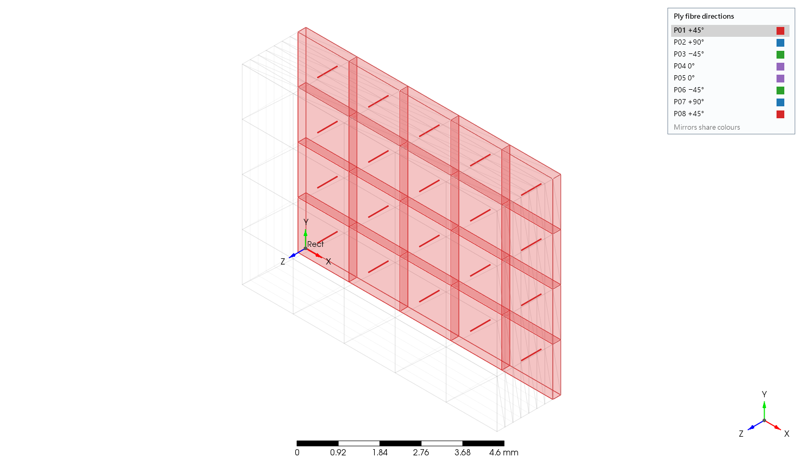

# PrePoMax-RCM 一鍵安裝

作者：S.Y. Su　版本：0.1.0-rc1g8-win.1 (RC)

**下載 Setup.exe → 雙擊 → 完成**

1. 到 [GitHub Releases](https://github.com/isisam/PrePoMax_Linux/releases) 下載 `PrePoMax-RCM_Setup_0.1.0-rc1g8-win.1.exe`。
2. 雙擊，按「下一步」→「安裝」→「完成」。不需管理員密碼。
3. 預設裝到 `%LOCALAPPDATA%\Programs\PrePoMax-RCM`。
4. 用桌面或開始選單的 PrePoMax-RCM 捷徑開啟；求解器路徑已設定好。

若 SmartScreen 顯示未知發行者：本包未以商業憑證簽章，因此可能顯示「未知發行者」。確認檔案來自上述 GitHub release，並比對 SHA256SUMS 後，在 SmartScreen 按「其他資訊」→「仍要執行」。若學校政策不允許，請聯絡學校 IT；不必關閉防毒或安全設定。

完成後：開啟桌面 PrePoMax-RCM 捷徑。將 `Examples\Layup\Layup.pmx` 複製到自己的工作資料夾再開啟。於模型樹開啟疊層項目，可檢查每層方向與顏色。選分析工作後按執行，即使用內附 stock CalculiX。

上圖是 RC1g8 候選包既有的疊層畫面截圖，供辨認功能；不是本次安裝精靈截圖，也不代表 150% DPI 人工檢查已通過。

解除安裝：在 Windows「設定 → 應用程式 → 已安裝的應用程式」選擇本程式並解除安裝，或執行安裝資料夾的 `Uninstall.exe`。會移除本包檔案、捷徑與登錄項目。請將自己修改的範例另存到工作資料夾；解除安裝會移除本包附的範例，另存的模型與計算結果會保留。

詳細功能與需求見 [繁中功能說明](FEATURES_zh-TW.md)／[English features](FEATURES_en.md)。
